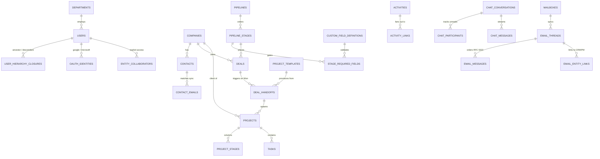
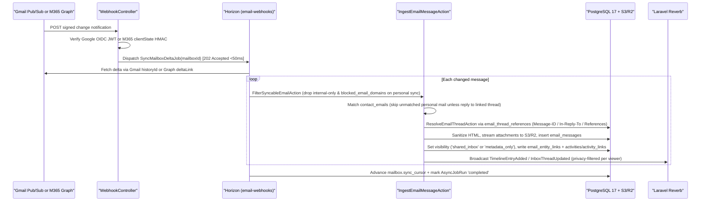
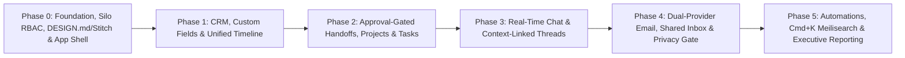

# Internal All-in-One Workspace — Architecture & Phased Implementation Plan

> **For agentic workers:** REQUIRED SUB-SKILL: Use `superpowers:subagent-driven-development` (recommended) or `superpowers:executing-plans` together with `design-md` (Google Stitch-first UI gate) and `core-implementation` to implement this plan phase-by-phase and task-by-task. Steps use checkbox (`- [ ]`) syntax for tracking.

**Goal:** Build a greenfield, high-density internal enterprise workspace on the VILT stack unifying **CRM**, **Project Management**, **Real-Time Chat**, and **Dual-Provider Email (Google Workspace & Microsoft 365)** for ~1,000 internal employees deployed on VPS + Coolify.

**Architecture:** Domain-organized Modular Monolith (`Core`, `Crm`, `Projects`, `Chat`, `Email`) enforcing strict `Controller -> FormRequest/Data DTO -> Action -> Model` boundaries, PostgreSQL 17 closure-table + collaborator strict siloed RBAC, a two-table fan-out Unified Activity Timeline (`activities` + `activity_links`), Inertia v2 Persistent Layouts + Pinia for live Reverb WebSockets and persistent drafts, and Horizon-orchestrated RFC 5322 email sync & Meilisearch indexing.

**Tech Stack:** PHP 8.4, Laravel 12, Inertia.js v2, Vue 3.5 (TypeScript strict), Tailwind CSS v4, Pinia, shadcn-vue / Reka UI, TanStack Table v8, TipTap v2, `spatie/laravel-data` + `spatie/laravel-typescript-transformer`, `spatie/laravel-permission`, PostgreSQL 17, Redis 7.4, Laravel Horizon, Laravel Reverb + Laravel Echo, Laravel Scout + Meilisearch v1.12, S3/Cloudflare R2 (presigned URLs), Pest v3, Vitest, Playwright, Docker + Coolify.

**Scope & Execution Strategy:** Because this platform spans six major subsystems (`Phase 0` Foundation through `Phase 5` Automations & Global Search), this document serves as the **Master System Architecture Spec** plus the **ready-to-execute Task Plan for Phase 0** and **milestone blueprints for Phases 1–5**. Each phase ships working, verified software independently; before starting Phases 1–5, expand that phase's blueprint into bite-sized TDD tasks in `docs/superpowers/plans/YYYY-MM-DD-phase-N-<module>.md`.

---

## Global Constraints

- **User Scale & Hosting:** Architect for **~1,000 active internal employees** (concurrent Reverb sockets, Horizon email sync bursts, sub-100ms siloed list queries) hosted on **VPS + Coolify**.
- **Dual Identity & Mail Providers:** First-class concurrent support for **Google Workspace** (OIDC + Gmail API v1 + Cloud Pub/Sub) and **Microsoft 365** (Entra ID OIDC + Microsoft Graph v1.0 + Webhook Subscriptions).
- **Strict Siloed Scoping:** Users may **only** view `Company`, `Contact`, `Deal`, and `Project` records owned by themselves, owned by subordinates in their reporting tree (`Director -> Manager -> Rep` via `user_hierarchy_closures`), or explicitly granted via `entity_collaborators` (plus controlled intake access on `deal_handoffs` for `Operations Manager`).
- **Personal Email Privacy Boundary:** Shared team inboxes (`sales@`, `support@`) expose full bodies to authorized inbox/entity viewers; personal 2-way synced employee emails exclude `blocked_email_domains` and default to **`metadata_only`** (`Subject`, `From`, `To`, `Timestamp`) on the Unified Activity Timeline until the mailbox owner explicitly shares the body (`shared_body`).
- **Approval-Gated Deal-to-Project Handoff:** Marking a Deal `Won` validates stage-required fields and creates a `deal_handoffs` intake record (`pending_review`); an `Operations Manager` or `Project Manager` reviews, selects a `ProjectTemplate`, assigns `PM` + `Account Manager`, and approves to provision Project(s), Tasks, and linked Chat threads.
- **Layer & State Discipline:** Enforce `Controller -> FormRequest/Data -> Action -> Model` + Laravel `Policies`; use UUIDv7 primary keys; pass database record IDs across jobs/events; track every background job in `async_job_runs` (`queued` | `running` | `completed` | `failed`); author `DESIGN.md` and lock screens in Google Stitch MCP (`stitch`) before writing UI components.

## Review Focus

1. **Cross-Silo Data Leak via Search or WebSockets:** A Sales Rep in Team A types a competitor/client name into `Cmd+K` Meilisearch or listens on a pipeline Kanban Reverb channel and sees a Deal owned by Team B — prevented by mandatory server-side Meilisearch `authorized_viewer_ids` filter tokens and ID-only / user-scoped Reverb invalidations, verified by dedicated cross-silo negative tests in Phases 0, 1, and 5.
2. **Executive / HR Personal Email Leakage on Timeline:** An employee's 2-way personal sync ingests an internal HR compensation email or exposes a confidential client email body to co-assigned reps — prevented by pre-ingestion `blocked_email_domains` drop rules (dropping purely internal and blocklisted-domain emails before DB write) and DTO-enforced `metadata_only` body stripping tested in Phase 4.
3. **Concurrent Kanban Drag & Stage-Gate Race Conditions:** Two users drag the same Deal/Task simultaneously, or move a Deal to `Won` via Kanban drag bypassing required custom fields — prevented by optimistic `version` locking (`409 Conflict` rollback toast) and running all Kanban stage transitions through the exact same `MoveDealStageAction` stage-gate validator tested in Phase 1 & Phase 2.
4. **Duplicate Outbound Emails or Duplicate Handoff Projects on Queue Retry:** A transient network timeout after Gmail/Graph sends an email (or midway through `ApproveDealHandoffAction`) causes Horizon retry to send duplicate client emails or create duplicate Projects — prevented by `Cache::lock` + `idempotency_key` checks on `email_messages.send_status` and `deal_handoffs.status` tested in Phases 2 & 4.
5. **Stale Reporting-Tree Visibility After Manager Reassignment:** Moving a Manager or Rep to a new Director leaves stale `user_hierarchy_closures` rows or stale Meilisearch `authorized_viewer_ids`, leaking old silo records — prevented by transactional closure rebuild (`RebuildUserHierarchyClosureAction`), immediate Redis cache bust, and queued `ReindexSiloPermissionsJob` tested in Phase 0.

---

## 1. Locked Architectural Decisions (From Clarifying Q&A)

| Decision Area | Confirmed Choice | Architectural Impact |
| :--- | :--- | :--- |
| **1. Identity, Mail & Scale** | **Google Workspace + Microsoft 365 concurrently**, ~1,000 internal users on **Coolify/VPS** | Dual OIDC Socialite drivers (`hd` / `tid` tenant-locked) + `MailProviderContract` (`GmailDriver`, `MicrosoftGraphDriver`) + dedicated Reverb & Horizon containers. |
| **2. Email Scope & Timeline Privacy** | **Shared team inboxes + Personal 2-way sync**; personal mail defaults to **`metadata_only`** + domain blocklist | Pre-storage domain/internal filter; `email_threads.visibility` (`shared_inbox`, `metadata_only`, `shared_body`) enforced in `EmailThreadData` & `ActivityTimelineData` transformers. |
| **3. Multi-Department RBAC** | **Strict siloed scoping** (`Director -> Manager -> Rep` + explicit assignment) across 8 roles | `user_hierarchy_closures` table + `entity_collaborators` pivot + Redis-cached `VisibleScope` applied uniformly to SQL queries, Reverb channels, S3 attachments, and Meilisearch filters. |
| **4. CRM Pipelines & Custom Fields** | **Multiple pipelines** + Admin-defined typed `jsonb` custom fields + **per-stage required field gates** | `pipelines`, `pipeline_stages`, `custom_field_definitions`, `stage_required_fields`, PostgreSQL `GIN (custom_fields jsonb_path_ops)`, and dynamic validator in `MoveDealStageAction`. |
| **5. Deal-to-Project Handoff** | **Approval-gated intake** (`Deal Won` → `Pending Handoff` → Ops/PM approves & picks template) | `deal_handoffs` state machine (`pending_review` → `changes_requested` / `approved` → `provisioned` / `rejected`) bridging Sales and Delivery silos cleanly. |
| **6. Chat & Context Threads** | **Internal employees only**: `#channels` + `DMs` + **embedded context-linked threads** | Unified `chat_conversations` (`public_channel`, `private_channel`, `direct`, `group_dm`, `entity_thread`) syncing embedded Deal/Project/Task/Email threads with global Chat unreads & `@mentions`. |

---

## 2. Domain & PostgreSQL 17 Schema Design

> [!IMPORTANT]
> **Why PostgreSQL 17 (Locked Over MySQL 8.4):** PostgreSQL 17 gives us `GIN (custom_fields jsonb_path_ops)` for sub-millisecond custom CRM filtering without EAV join tables, `citext` / case-insensitive deterministic email matching, `= ANY($1::uuid[])` array bindings for 1,000-user hierarchy scopes, partial indexes (`WHERE deleted_at IS NULL`), and transactional DDL migrations. Every primary key uses **UUIDv7** (`HasUuids` ordered UUIDs) for B-tree insert locality and IDOR resistance.

### 2.1 Core Entity-Relationship Diagram



### 2.2 Complete Table & Column Specifications

#### Module A: `Core` (Org Hierarchy, Identity, RBAC, Storage & Job Tracking)

1. **`departments`**
   - `id uuid PK`, `name varchar(120)`, `slug varchar(120) UNIQUE`, `parent_id uuid NULL FK(departments)`, `timestamps`
2. **`teams`**
   - `id uuid PK`, `department_id uuid FK(departments)`, `name varchar(120)`, `lead_user_id uuid NULL FK(users)`, `timestamps`
3. **`users`**
   - `id uuid PK`, `employee_code varchar(32) UNIQUE`, `name varchar(150)`, `email citext UNIQUE`, `avatar_key varchar(255) NULL`, `department_id uuid FK(departments)`, `primary_team_id uuid NULL FK(teams)`, `manager_id uuid NULL FK(users)`, `job_title varchar(120) NULL`, `status varchar(24) DEFAULT 'active'` (`active` | `suspended` | `offboarded`), `timezone varchar(64) DEFAULT 'UTC'`, `last_seen_at timestamptz NULL`, `timestamps`, `deleted_at timestamptz NULL`
   - Indexes: `idx_users_manager (manager_id)`, `idx_users_dept_status (department_id, status)`
4. **`user_hierarchy_closures`** *(Materialized Reporting Tree for Strict Siloed Scoping)*
   - `ancestor_id uuid FK(users)`, `descendant_id uuid FK(users)`, `depth smallint NOT NULL` (`0` = self, `1` = direct report, `2+` = skip-level)
   - `PRIMARY KEY (ancestor_id, descendant_id)`, `INDEX idx_closure_descendant (descendant_id)`
5. **`oauth_identities`**
   - `id uuid PK`, `user_id uuid FK(users)`, `provider varchar(24)` (`google` | `microsoft`), `provider_tenant_id varchar(128)`, `provider_user_id varchar(128)`, `email citext`, `access_token text` *(encrypted)*, `refresh_token text NULL` *(encrypted)*, `token_expires_at timestamptz NULL`, `scopes jsonb DEFAULT '[]'`, `timestamps`
   - `UNIQUE (provider, provider_user_id)`, `INDEX (user_id, provider)`
6. **`roles`, `permissions`, `model_has_roles`, `role_has_permissions`** (`spatie/laravel-permission` with `uuid` morph keys)
7. **`entity_collaborators`** *(Explicit Cross-Silo Assignment & Co-Ownership)*
   - `id uuid PK`, `collaboratable_type varchar(32)` (`company` | `contact` | `deal` | `project`), `collaboratable_id uuid`, `user_id uuid FK(users)`, `access_level varchar(16)` (`viewer` | `editor` | `manager`), `role_label varchar(32)` (`account_manager` | `project_manager` | `sales_overlay` | `support_lead` | `it_lead` | `observer`), `granted_by_id uuid FK(users)`, `created_at timestamptz`
   - `UNIQUE (collaboratable_type, collaboratable_id, user_id)`
   - `INDEX idx_collab_user_lookup (user_id, collaboratable_type, collaboratable_id)`
8. **`attachments` & `attachment_links`**
   - `attachments`: `id uuid PK`, `uploaded_by_id uuid FK(users)`, `disk varchar(24) DEFAULT 's3'`, `bucket varchar(120)`, `object_key varchar(512) UNIQUE`, `original_filename varchar(255)`, `mime_type varchar(127)`, `size_bytes bigint`, `sha256 char(64)`, `scan_status varchar(24) DEFAULT 'clean'` (`pending` | `clean` | `quarantined`), `created_at timestamptz`
   - `attachment_links`: `id uuid PK`, `attachment_id uuid FK(attachments)`, `attachable_type varchar(32)` (`note` | `task` | `chat_message` | `email_message` | `deal_handoff`), `attachable_id uuid`, `created_at timestamptz`, `UNIQUE (attachment_id, attachable_type, attachable_id)`
9. **`async_job_runs`** *(Explicit Async State Machine)*
   - `id uuid PK`, `job_class varchar(180)`, `queue varchar(64)`, `subject_type varchar(32) NULL`, `subject_id uuid NULL`, `triggered_by_id uuid NULL FK(users)`, `status varchar(16)` (`queued` | `running` | `completed` | `failed`), `attempt smallint DEFAULT 1`, `idempotency_key varchar(191) NULL UNIQUE`, `payload_summary jsonb DEFAULT '{}'`, `error_code varchar(64) NULL`, `error_message text NULL`, `queued_at timestamptz`, `started_at timestamptz NULL`, `finished_at timestamptz NULL`
   - Indexes: `idx_job_subject (subject_type, subject_id, queued_at DESC)`, `idx_job_status_queue (status, queue)`

#### Module B: `Crm` (Companies, Contacts, Pipelines, Deals, Custom Fields & Unified Timeline)

1. **`companies`**
   - `id uuid PK`, `name varchar(200)`, `domain citext NULL`, `lifecycle_stage varchar(24) DEFAULT 'prospect'` (`lead` | `prospect` | `active_client` | `churned` | `partner`), `industry varchar(100) NULL`, `employee_range varchar(32) NULL`, `annual_revenue_cents bigint NULL`, `billing_address jsonb DEFAULT '{}'`, `owner_id uuid FK(users)`, `account_manager_id uuid NULL FK(users)`, `custom_fields jsonb NOT NULL DEFAULT '{}'`, `authorized_viewer_ids uuid[] NOT NULL DEFAULT '{}'` *(denormalized helper synced for Meilisearch)*, `timestamps`, `deleted_at timestamptz NULL`
   - Indexes: `idx_companies_owner (owner_id) WHERE deleted_at IS NULL`, `idx_companies_am (account_manager_id) WHERE deleted_at IS NULL`, `idx_companies_domain (domain)`, `idx_companies_cf GIN (custom_fields jsonb_path_ops)`
2. **`contacts` & `contact_emails`**
   - `contacts`: `id uuid PK`, `company_id uuid NULL FK(companies)`, `owner_id uuid FK(users)`, `first_name varchar(100)`, `last_name varchar(100)`, `full_name varchar(201) GENERATED ALWAYS AS (trim(first_name || ' ' || last_name)) STORED`, `primary_email citext NULL`, `phones jsonb DEFAULT '[]'`, `job_title varchar(120) NULL`, `is_primary_contact boolean DEFAULT false`, `custom_fields jsonb NOT NULL DEFAULT '{}'`, `timestamps`, `deleted_at timestamptz NULL`
   - `contact_emails`: `id uuid PK`, `contact_id uuid FK(contacts) ON DELETE CASCADE`, `email citext NOT NULL`, `is_primary boolean DEFAULT false`, `UNIQUE (contact_id, email)`, `INDEX idx_contact_emails_lookup (email)`
   - Indexes on `contacts`: `idx_contacts_company (company_id)`, `idx_contacts_owner (owner_id)`, `idx_contacts_cf GIN (custom_fields jsonb_path_ops)`
3. **`pipelines` & `pipeline_stages`**
   - `pipelines`: `id uuid PK`, `name varchar(120)`, `slug varchar(120) UNIQUE`, `department_id uuid NULL FK(departments)`, `is_default boolean DEFAULT false`, `is_active boolean DEFAULT true`, `sort_order int DEFAULT 0`, `timestamps`
   - `pipeline_stages`: `id uuid PK`, `pipeline_id uuid FK(pipelines) ON DELETE CASCADE`, `name varchar(100)`, `stage_type varchar(16) DEFAULT 'open'` (`open` | `won` | `lost`), `win_probability smallint DEFAULT 10`, `rotting_days smallint NULL`, `required_core_fields jsonb DEFAULT '[]'` *(e.g., `["expected_close_date", "amount_cents"]`)*, `sort_order int`, `timestamps`, `INDEX (pipeline_id, sort_order)`
4. **`custom_field_definitions` & `stage_required_fields`**
   - `custom_field_definitions`: `id uuid PK`, `entity_type varchar(24)` (`company` | `contact` | `deal` | `project`), `pipeline_id uuid NULL FK(pipelines)` *(null = applies across all pipelines for `deal`)*, `key varchar(64)` *(immutable snake_case key inside `custom_fields` JSONB)*, `label varchar(120)`, `field_type varchar(24)` (`text` | `textarea` | `number` | `currency` | `boolean` | `date` | `select` | `multi_select` | `user_id` | `url`), `options jsonb NULL`, `validation_rules jsonb DEFAULT '{}'`, `is_filterable boolean DEFAULT true`, `is_active boolean DEFAULT true`, `sort_order int DEFAULT 0`, `timestamps`, `UNIQUE (entity_type, key)`
   - `stage_required_fields`: `pipeline_stage_id uuid FK(pipeline_stages) ON DELETE CASCADE`, `custom_field_definition_id uuid FK(custom_field_definitions) ON DELETE CASCADE`, `PRIMARY KEY (pipeline_stage_id, custom_field_definition_id)`
5. **`deals` & `deal_contacts`**
   - `deals`: `id uuid PK`, `company_id uuid FK(companies)`, `primary_contact_id uuid NULL FK(contacts)`, `pipeline_id uuid FK(pipelines)`, `stage_id uuid FK(pipeline_stages)`, `owner_id uuid FK(users)`, `account_manager_id uuid NULL FK(users)`, `title varchar(200)`, `amount_cents bigint NOT NULL DEFAULT 0`, `currency char(3) DEFAULT 'USD'`, `expected_close_date date NULL`, `stage_entered_at timestamptz NOT NULL`, `won_at timestamptz NULL`, `lost_at timestamptz NULL`, `lost_reason varchar(255) NULL`, `board_position double precision NOT NULL DEFAULT 65536`, `custom_fields jsonb NOT NULL DEFAULT '{}'`, `version int NOT NULL DEFAULT 1`, `timestamps`, `deleted_at timestamptz NULL`
   - Indexes: `idx_deals_kanban (pipeline_id, stage_id, board_position) WHERE deleted_at IS NULL`, `idx_deals_owner (owner_id) WHERE deleted_at IS NULL`, `idx_deals_company (company_id)`, `idx_deals_cf GIN (custom_fields jsonb_path_ops)`
   - `deal_contacts`: `deal_id uuid FK(deals)`, `contact_id uuid FK(contacts)`, `stakeholder_role varchar(32)` (`decision_maker` | `champion` | `billing` | `technical_buyer` | `influencer`), `PRIMARY KEY (deal_id, contact_id)`
6. **`notes`**
   - `id uuid PK`, `author_id uuid FK(users)`, `body_json jsonb NOT NULL` *(TipTap ProseMirror AST)*, `body_text text NOT NULL`, `is_pinned boolean DEFAULT false`, `timestamps`, `deleted_at timestamptz NULL`
7. **Unified Activity Timeline (`activities` + `activity_links`)**
   - `activities`: `id uuid PK`, `actor_id uuid NULL FK(users)`, `activity_type varchar(40)` (`note_created` | `deal_created` | `stage_changed` | `field_updated` | `task_created` | `task_completed` | `email_received` | `email_sent` | `chat_thread_created` | `handoff_submitted` | `handoff_approved` | `project_provisioned`), `source_type varchar(32)` (`note` | `deal` | `task` | `email_message` | `chat_conversation` | `deal_handoff` | `project`), `source_id uuid NOT NULL`, `visibility_mode varchar(32) DEFAULT 'source_policy'` (`source_policy` | `email_privacy_gated`), `summary varchar(255)`, `metadata jsonb DEFAULT '{}'` *(stores IDs + scalar diffs only — never sensitive prose)*, `occurred_at timestamptz NOT NULL`, `created_at timestamptz`
   - `activity_links`: `linkable_type varchar(24)` (`company` | `contact` | `deal` | `project`), `linkable_id uuid NOT NULL`, `occurred_at timestamptz NOT NULL`, `activity_id uuid FK(activities) ON DELETE CASCADE`
   - `PRIMARY KEY (linkable_type, linkable_id, occurred_at DESC, activity_id DESC)` — **Clustered composite key gives zero-sort index-only cursor pagination across Company, Contact, Deal, and Project timelines.**

#### Module C: `Projects` (Templates, Approval-Gated Deal Handoffs, Projects & Tasks)

1. **`project_templates` & `project_template_tasks`**
   - `project_templates`: `id uuid PK`, `name varchar(150)`, `department_id uuid NULL FK(departments)`, `default_stages jsonb NOT NULL` *(ordered stage definitions)*, `description text NULL`, `is_active boolean DEFAULT true`, `created_by_id uuid FK(users)`, `timestamps`
   - `project_template_tasks`: `id uuid PK`, `project_template_id uuid FK(project_templates) ON DELETE CASCADE`, `parent_template_task_id uuid NULL FK(project_template_tasks)`, `stage_key varchar(64)`, `title varchar(200)`, `description_json jsonb NULL`, `relative_due_days int NULL`, `assignee_role_hint varchar(32) NULL` (`pm` | `am` | `support` | `it`), `sort_order int DEFAULT 0`
2. **`deal_handoffs`** *(Approval-Gated Intake Queue)*
   - `id uuid PK`, `deal_id uuid FK(deals)`, `company_id uuid FK(companies)`, `submitted_by_id uuid FK(users)`, `reviewed_by_id uuid NULL FK(users)`, `assigned_pm_id uuid NULL FK(users)`, `assigned_am_id uuid NULL FK(users)`, `project_template_id uuid NULL FK(project_templates)`, `status varchar(24) NOT NULL DEFAULT 'pending_review'` (`pending_review` | `changes_requested` | `approved` | `provisioned` | `rejected`), `scope_notes_json jsonb NOT NULL`, `handoff_checklist jsonb DEFAULT '[]'`, `target_kickoff_date date NULL`, `review_feedback text NULL`, `submitted_at timestamptz NOT NULL`, `reviewed_at timestamptz NULL`, `provisioned_at timestamptz NULL`, `timestamps`
   - Indexes: `idx_handoffs_queue (status, submitted_at DESC)`, `idx_handoffs_deal (deal_id)`
3. **`projects`, `deal_project` & `project_stages`**
   - `projects`: `id uuid PK`, `code varchar(24) UNIQUE` *(e.g., `PRJ-2026-0001`)*, `company_id uuid NULL FK(companies)`, `primary_deal_id uuid NULL FK(deals)`, `deal_handoff_id uuid NULL FK(deal_handoffs)`, `owner_id uuid FK(users)` *(Assigned PM)*, `account_manager_id uuid NULL FK(users)`, `department_id uuid FK(departments)`, `name varchar(200)`, `description_json jsonb NULL`, `status varchar(24) DEFAULT 'planning'` (`planning` | `active` | `on_hold` | `completed` | `cancelled`), `health varchar(16) DEFAULT 'on_track'` (`on_track` | `at_risk` | `off_track`), `start_date date NULL`, `target_end_date date NULL`, `completed_at timestamptz NULL`, `custom_fields jsonb NOT NULL DEFAULT '{}'`, `timestamps`, `deleted_at timestamptz NULL`
   - `deal_project`: `deal_id uuid FK(deals)`, `project_id uuid FK(projects)`, `PRIMARY KEY (deal_id, project_id)` *(supports 1-Deal-to-Many-Projects and Upsell-Deals-to-Existing-Project)*
   - `project_stages`: `id uuid PK`, `project_id uuid FK(projects) ON DELETE CASCADE`, `name varchar(80)`, `category varchar(24)` (`backlog` | `todo` | `in_progress` | `review` | `done` | `cancelled`), `sort_order int`, `wip_limit smallint NULL`, `INDEX (project_id, sort_order)`
4. **`tasks` & `task_watchers`**
   - `tasks`: `id uuid PK`, `project_id uuid NULL FK(projects)`, `project_stage_id uuid NULL FK(project_stages)`, `parent_task_id uuid NULL FK(tasks)`, `linkable_type varchar(24) NULL` (`company` | `contact` | `deal` | `email_thread`), `linkable_id uuid NULL`, `creator_id uuid FK(users)`, `assignee_id uuid NULL FK(users)`, `title varchar(255)`, `description_json jsonb NULL`, `priority varchar(16) DEFAULT 'medium'` (`low` | `medium` | `high` | `urgent`), `status varchar(24) DEFAULT 'todo'` (`todo` | `in_progress` | `blocked` | `review` | `done` | `cancelled`), `board_position double precision NOT NULL DEFAULT 65536`, `due_at timestamptz NULL`, `completed_at timestamptz NULL`, `estimated_minutes int NULL`, `version int NOT NULL DEFAULT 1`, `timestamps`, `deleted_at timestamptz NULL`
   - Indexes: `idx_tasks_board (project_id, project_stage_id, board_position) WHERE deleted_at IS NULL`, `idx_tasks_my_work (assignee_id, status, due_at) WHERE deleted_at IS NULL`, `idx_tasks_linkable (linkable_type, linkable_id)`
   - `task_watchers`: `task_id uuid FK(tasks) ON DELETE CASCADE`, `user_id uuid FK(users)`, `PRIMARY KEY (task_id, user_id)`

#### Module D: `Chat` (Unified Channels, DMs & Context-Linked Entity Threads)

1. **`chat_conversations`**
   - `id uuid PK`, `type varchar(24) NOT NULL` (`public_channel` | `private_channel` | `direct` | `group_dm` | `entity_thread`), `slug varchar(120) NULL UNIQUE`, `name varchar(120) NULL`, `topic varchar(255) NULL`, `direct_pair_key varchar(75) NULL UNIQUE` *(sorted `"{minUuid}:{maxUuid}"` preventing duplicate 1:1 DMs)*, `context_type varchar(24) NULL` (`company` | `deal` | `project` | `task` | `email_thread`), `context_id uuid NULL`, `department_id uuid NULL FK(departments)` *(null on `public_channel` = company-wide; set = department channel)*, `created_by_id uuid FK(users)`, `is_archived boolean DEFAULT false`, `last_message_at timestamptz NULL`, `timestamps`
   - Indexes: `idx_chat_context (context_type, context_id)`, `idx_chat_list (type, is_archived, last_message_at DESC)`
2. **`chat_participants`**
   - `conversation_id uuid FK(chat_conversations) ON DELETE CASCADE`, `user_id uuid FK(users)`, `role varchar(16) DEFAULT 'member'` (`owner` | `admin` | `member`), `last_read_message_id uuid NULL`, `last_read_at timestamptz NULL`, `unread_count int NOT NULL DEFAULT 0`, `mention_count int NOT NULL DEFAULT 0`, `notification_pref varchar(16) DEFAULT 'all'` (`all` | `mentions` | `muted`), `joined_at timestamptz NOT NULL`, `PRIMARY KEY (conversation_id, user_id)`
   - Partial Index: `idx_chat_unreads (user_id, unread_count) WHERE unread_count > 0`
3. **`chat_messages`, `chat_message_reactions` & `chat_mentions`**
   - `chat_messages`: `id uuid PK` *(UUIDv7)*, `conversation_id uuid FK(chat_conversations) ON DELETE CASCADE`, `parent_message_id uuid NULL FK(chat_messages)`, `sender_id uuid NULL FK(users)`, `client_temp_id uuid NULL`, `message_type varchar(16) DEFAULT 'user'` (`user` | `system`), `body_json jsonb NOT NULL`, `body_text text NOT NULL`, `reply_count int NOT NULL DEFAULT 0`, `edited_at timestamptz NULL`, `timestamps`, `deleted_at timestamptz NULL`
   - Indexes: `UNIQUE (sender_id, client_temp_id)`, `idx_messages_stream (conversation_id, id DESC) WHERE deleted_at IS NULL`
   - `chat_message_reactions`: `message_id uuid FK(chat_messages) ON DELETE CASCADE`, `user_id uuid FK(users)`, `emoji varchar(32)`, `created_at timestamptz`, `PRIMARY KEY (message_id, user_id, emoji)`
   - `chat_mentions`: `id uuid PK`, `message_id uuid FK(chat_messages) ON DELETE CASCADE`, `mentioned_user_id uuid NULL FK(users)`, `broadcast_target varchar(16) NULL` (`here` | `channel`), `entity_ref_type varchar(24) NULL`, `entity_ref_id uuid NULL`, `INDEX (mentioned_user_id)`

#### Module E: `Email` (Dual Google/M365 Sync, RFC 5322 Threading, Shared Inbox & Privacy Gate)

1. **`mailboxes` & `shared_inbox_members`**
   - `mailboxes`: `id uuid PK`, `mailbox_type varchar(24) NOT NULL` (`shared_team` | `personal_employee`), `owner_user_id uuid NULL FK(users)`, `department_id uuid NULL FK(departments)`, `email_address citext UNIQUE`, `display_name varchar(150)`, `provider varchar(24) NOT NULL` (`google_workspace` | `microsoft_365`), `oauth_identity_id uuid FK(oauth_identities)`, `sync_status varchar(24) DEFAULT 'initial_backfill'` (`active` | `initial_backfill` | `reauth_required` | `paused` | `error`), `sync_cursor text NULL` *(Gmail `historyId` or Graph `deltaLink`)*, `watch_subscription_id varchar(255) NULL`, `watch_webhook_secret varchar(128) NULL`, `watch_expires_at timestamptz NULL`, `default_personal_visibility varchar(24) DEFAULT 'metadata_only'` (`metadata_only` | `shared_body`), `last_synced_at timestamptz NULL`, `timestamps`
   - `shared_inbox_members`: `mailbox_id uuid FK(mailboxes) ON DELETE CASCADE`, `user_id uuid FK(users)`, `can_send_as boolean DEFAULT true`, `can_assign boolean DEFAULT true`, `PRIMARY KEY (mailbox_id, user_id)`
2. **`blocked_email_domains`**
   - `id uuid PK`, `pattern citext UNIQUE` *(e.g. internal company domains, `workday.com`, `adp.com`, `hr@*`)*, `reason varchar(150)`, `created_by_id uuid FK(users)`, `created_at timestamptz`
3. **`email_threads`, `email_messages`, `email_thread_references` & `email_entity_links`**
   - `email_threads`: `id uuid PK`, `mailbox_id uuid FK(mailboxes) ON DELETE CASCADE`, `provider_thread_id varchar(255) NULL`, `subject varchar(500)`, `snippet varchar(500) NULL`, `visibility varchar(24) NOT NULL` (`shared_inbox` | `metadata_only` | `shared_body`), `shared_by_user_id uuid NULL FK(users)`, `shared_at timestamptz NULL`, `inbox_status varchar(16) NULL` (`open` | `pending` | `snoozed` | `closed`), `snoozed_until timestamptz NULL`, `assigned_to_id uuid NULL FK(users)`, `message_count int NOT NULL DEFAULT 1`, `has_attachments boolean DEFAULT false`, `last_message_at timestamptz NOT NULL`, `timestamps`
   - Indexes: `UNIQUE (mailbox_id, provider_thread_id)`, `idx_shared_inbox_queue (mailbox_id, inbox_status, last_message_at DESC)`, `idx_inbox_assignee (assigned_to_id, inbox_status)`
   - `email_messages`: `id uuid PK`, `thread_id uuid FK(email_threads) ON DELETE CASCADE`, `mailbox_id uuid FK(mailboxes)`, `provider_message_id varchar(255) NULL`, `direction varchar(16)` (`inbound` | `outbound`), `send_status varchar(16)` (`received` | `queued` | `sending` | `sent` | `failed`), `sent_by_user_id uuid NULL FK(users)`, `rfc_message_id varchar(320) NOT NULL` *(RFC 5322 `Message-ID`)*, `in_reply_to varchar(320) NULL` *(RFC 5322 `In-Reply-To`)*, `references_header jsonb NOT NULL DEFAULT '[]'` *(ordered RFC 5322 `References` list)*, `from_address citext NOT NULL`, `from_name varchar(180) NULL`, `to_recipients jsonb NOT NULL DEFAULT '[]'`, `cc_recipients jsonb NOT NULL DEFAULT '[]'`, `bcc_recipients jsonb NOT NULL DEFAULT '[]'`, `subject varchar(500)`, `body_html_sanitized text NULL`, `body_text text NULL`, `sent_at timestamptz NOT NULL`, `received_at timestamptz NOT NULL`, `timestamps`
   - Indexes: `UNIQUE (mailbox_id, provider_message_id)`, `idx_email_rfc_msgid (rfc_message_id)`, `idx_email_in_reply_to (in_reply_to)`, `idx_email_refs GIN (references_header jsonb_path_ops)`
   - `email_thread_references`: `mailbox_id uuid FK(mailboxes) ON DELETE CASCADE`, `rfc_message_id varchar(320)`, `thread_id uuid FK(email_threads) ON DELETE CASCADE`, `PRIMARY KEY (mailbox_id, rfc_message_id)`
   - `email_entity_links`: `id uuid PK`, `thread_id uuid FK(email_threads) ON DELETE CASCADE`, `linkable_type varchar(24)` (`company` | `contact` | `deal` | `project`), `linkable_id uuid NOT NULL`, `link_origin varchar(24)` (`auto_contact` | `auto_header` | `manual`), `linked_by_user_id uuid NULL FK(users)`, `created_at timestamptz`, `UNIQUE (thread_id, linkable_type, linkable_id)`, `INDEX (linkable_type, linkable_id)`
4. **`email_drafts`**
   - `id uuid PK`, `mailbox_id uuid FK(mailboxes)`, `author_id uuid FK(users)`, `reply_to_thread_id uuid NULL FK(email_threads)`, `reply_to_message_id uuid NULL FK(email_messages)`, `to_recipients jsonb DEFAULT '[]'`, `cc_recipients jsonb DEFAULT '[]'`, `bcc_recipients jsonb DEFAULT '[]'`, `subject varchar(500) DEFAULT ''`, `body_json jsonb NOT NULL`, `linked_entities jsonb DEFAULT '[]'`, `version int DEFAULT 1`, `timestamps`

---

## 3. Modular Monolith Directory Structure (Laravel 12 + Vue 3 / Inertia v2)

```text
/Users/jelatz/Projects/CRM/
├── DESIGN.md                                  # Locked anti-slop UI design system (uploaded to Google Stitch)
├── docker-compose.yml                         # Dev & Coolify parity: app, horizon, reverb, postgres:17, redis:7.4, meilisearch
├── docker/                                    # FrankenPHP/PHP-8.4, Supervisor, PgBouncer configs
├── app/
│   ├── Providers/
│   │   ├── AppServiceProvider.php
│   │   └── ModularDomainServiceProvider.php   # Auto-registers module Policies, Gates, MorphMaps, Routes, Listeners
│   ├── Support/
│   │   ├── Silo/                              # VisibleScope, HasSiloVisibility trait, SiloSearchFilterBuilder
│   │   └── Http/                              # BaseController, IdempotencyMiddleware, ApiConflictException
│   └── Modules/
│       ├── Core/
│       │   ├── Auth/                          # OIDC Socialite (Google + Microsoft), SessionController
│       │   ├── Users/                         # User, Department, Team, HierarchyClosure, RebuildUserHierarchyClosureAction
│       │   ├── Rbac/                          # RoleEnum, PermissionEnum, CollaboratorActions
│       │   ├── Attachments/                   # PresignedUploadAction, PresignedDownloadAction, AttachmentPolicy
│       │   ├── AsyncJobs/                     # AsyncJobRun model, TrackedJob abstract base class
│       │   ├── Search/                        # GlobalCommandSearchAction (Cmd+K Meilisearch multi-index federated search)
│       │   └── Tests/                         # Colocated Core & Silo RBAC Pest suites
│       ├── Crm/
│       │   ├── Companies/                     # Controllers, Data/, Actions/, Models/Company.php, Policies/CompanyPolicy.php
│       │   ├── Contacts/                      # Contact, ContactEmail, UpsertContactAction, MergeContactsAction
│       │   ├── Pipelines/                     # Pipeline, PipelineStage, StageRequiredField
│       │   ├── CustomFields/                  # CustomFieldDefinition, ValidateEntityCustomFieldsAction
│       │   ├── Deals/                         # Deal, MoveDealStageAction, ReorderDealKanbanAction, MarkDealWonAction
│       │   ├── Notes/                         # Note, CreateNoteAction, SanitizeTipTapAstAction
│       │   ├── Timeline/                      # Activity, ActivityLink, RecordActivityAction, QueryEntityTimelineAction
│       │   └── Tests/
│       ├── Projects/
│       │   ├── Templates/                     # ProjectTemplate, ProjectTemplateTask
│       │   ├── Handoffs/                      # DealHandoff, SubmitDealHandoffAction, ReviewDealHandoffAction, ProvisionProjectFromHandoffAction
│       │   ├── Projects/                      # Project, ProjectStage, UpdateProjectHealthAction
│       │   ├── Tasks/                         # Task, MoveTaskStageAction, AssignTaskAction
│       │   └── Tests/
│       ├── Chat/
│       │   ├── Conversations/                 # ChatConversation, ChatParticipant, EnsureEntityThreadAction
│       │   ├── Messages/                      # ChatMessage, PostChatMessageAction, ToggleReactionAction, MarkConversationReadAction
│       │   ├── Presence/                      # Typing indicator & batched online status endpoints
│       │   └── Tests/
│       └── Email/
│           ├── Mailboxes/                     # Mailbox, ConnectMailboxAction, RenewMailboxWatchesCommand
│           ├── Providers/                     # MailProviderContract, GoogleGmailDriver, MicrosoftGraphDriver
│           ├── Sync/                          # WebhookControllers, SyncMailboxDeltaJob, FilterSyncableEmailAction
│           ├── Threading/                     # ResolveEmailThreadAction, AutoLinkEmailEntitiesAction
│           ├── SharedInbox/                   # AssignEmailThreadAction, ChangeInboxStatusAction
│           ├── Outbound/                      # SaveEmailDraftAction, QueueOutboundEmailAction, SendOutboundEmailJob
│           ├── Privacy/                       # SharePersonalEmailThreadAction, EmailVisibilityTransformer
│           └── Tests/
├── database/
│   ├── migrations/                            # Ordered timestamped migrations across domains
│   └── seeders/                               # RolesPermissionsSeeder, DemoOrgSeeder
├── routes/
│   ├── web.php                                # Mounts domain Inertia route files
│   ├── api_internal.php                       # Stateful Sanctum/session JSON routes for optimistic high-frequency UX
│   ├── webhooks.php                           # Signed stateless webhooks (Google Pub/Sub, Microsoft Graph)
│   └── channels.php                           # Reverb private/presence channel authorization gates
└── resources/
    └── js/
        ├── app.ts                             # Inertia v2 bootstrap + persistent WorkspaceShellLayout default
        ├── echo.ts                            # Laravel Echo + Reverb singleton client with exponential reconnect
        ├── types/
        │   └── generated.d.ts                 # Auto-generated from PHP Spatie Data DTOs & Enums
        ├── components/
        │   ├── ui/                            # shadcn-vue / Reka UI components themed strictly to DESIGN.md
        │   ├── data-table/                    # Reusable high-density TanStack Table wrapper (virtualized, column pinning, saved filters)
        │   ├── editor/                        # Shared TipTap rich editor (@mentions, #record-links, slash commands, attachments)
        │   └── command-palette/               # Unified Cmd+K Meilisearch modal
        ├── layouts/
        │   └── WorkspaceShellLayout.vue       # Persistent left rail, unread badges, active callout, docked Email/Draft tray
        ├── stores/
        │   ├── auth.store.ts
        │   ├── realtime.store.ts              # Manages Echo subscriptions & connection health banner
        │   ├── unreads.store.ts               # Live unread counts for Chat, Shared Inboxes, Handoff Intake, Notifications
        │   └── drafts.store.ts                # Keeps open Email & Chat TipTap drafts alive across Inertia navigations
        └── modules/
            ├── core/
            ├── crm/                           # Companies, Contacts, Deal Kanban, Deal Detail + Unified Timeline, Custom Fields Admin
            ├── projects/                      # Handoff Intake Queue, Project Kanban, Task List/Table, My Work
            ├── chat/                          # Split-pane Chat (#channels, DMs) + reusable <EntityThreadPanel />
            └── email/                         # Split-pane Shared & Personal Inbox, Thread Reader, Floating Docked Composer
```

---

## 4. Auth, Strict Siloed RBAC & Security Architecture

### 4.1 Dual Enterprise SSO (`Google Workspace` + `Microsoft 365`)
- **OIDC Login Flow:** Employees sign in with either **Google Workspace** or **Microsoft Entra ID** via Laravel Socialite (`openid profile email`).
- **Hard Tenant Verification:**
  - Google: Verify ID token `hd` claim matches `config('auth.sso.allowed_google_domains')` and `email_verified === true`.
  - Microsoft: Verify ID token `tid` claim matches `config('auth.sso.allowed_microsoft_tenant_ids')`.
  - Match existing provisioned `users.email` (or auto-provision as minimal employee profile if IT SCIM/JIT provisioning is enabled; suspended/offboarded users are rejected at callback and active Redis sessions are immediately purged).
- **Separated Mailbox OAuth:** Connecting a personal mailbox or IT-managed shared inbox uses a dedicated incremental consent flow (`ConnectMailboxAction`) requesting mail scopes (`gmail.modify`, `gmail.send` or Graph `Mail.ReadWrite`, `Mail.Send`, `offline_access`), storing encrypted tokens in `oauth_identities`.

### 4.2 Strict Siloed Visibility Engine (`VisibleScope`)
For any authenticated user `$viewer`:
1. `VisibleScopeResolver` fetches `$viewer`'s cached subordinate IDs from `user_hierarchy_closures` (`SELECT descendant_id FROM user_hierarchy_closures WHERE ancestor_id = :viewerId`, cached in Redis under `silo:descendants:{userId}`).
2. Let `$siloUserIds = [$viewer->id, ...$descendantIds]`.
3. A record (`Company`, `Contact`, `Deal`, `Project`) is **visible** to `$viewer` if and only if:
   - `$viewer->hasRole('admin')` *(system administration)*, **OR**
   - `record.owner_id IN $siloUserIds` or `record.account_manager_id IN $siloUserIds`, **OR**
   - `EXISTS` in `entity_collaborators` where `(collaboratable_type, collaboratable_id, user_id = $viewer->id)`.
   - *Controlled Handoff Exception:* When `deal_handoffs.status IN ('pending_review', 'changes_requested', 'approved')`, users with permission `handoffs.review` (`Operations Manager` and department `Director` of Operations/PM) can view the `DealHandoff` and read-only summary of its linked `Deal` and `Company` to assign a PM. Once `provisioned`, `ProvisionProjectFromHandoffAction` writes explicit `entity_collaborators` rows on the `Company` and `Contact` for the assigned `Project Manager` (`role_label: 'project_manager'`).

### 4.3 8-Role Permission & Silo Matrix

| Capability | Admin | Director | Sales | Account Mgr | Ops Manager | Project Mgr | Support | IT |
| :--- | :---: | :---: | :---: | :---: | :---: | :---: | :---: | :---: |
| **Row Visibility Scope** | All | Own + Reporting Tree + Collab | Own + Collab | Own + Assigned Accounts | Own + Tree + Handoff Queue | Own + Tree + Assigned Projects | Shared Support Inbox + Collab | IT Projects + System Health |
| **Companies & Contacts CRUD** | Full | Silo CRUD | Silo CRUD | Silo Read/Edit | Silo Read | Collaborator Read | Collaborator Read | Collaborator Read |
| **Deals & Stage Moves** | Full | Silo CRUD + Override Gates | Silo CRUD (Gate Enforced) | Upsell Pipeline CRUD | Read Handoff Deals | Collaborator Read | Collaborator Read | — |
| **Pipelines & Custom Fields Schema** | Full | Read | Read | Read | Read | Read | Read | Config Read |
| **Deal Handoff Intake Queue** | Full | Dept Approve | Submit + Respond | View Assigned | **Review, Pick Template, Approve** | View Assigned + Request Info | — | — |
| **Projects & Tasks** | Full | Silo CRUD | Linked Deal Read | Collaborator Read/Comment | Silo CRUD + Templates | **Silo CRUD + Stage/Task Mgmt** | Support Tasks CRUD | Internal IT Projects CRUD |
| **Shared Team Inboxes** | Manage All | Dept Inboxes | `sales@` (if member) | `accounts@` (if member) | `ops@` (if member) | — | **`support@` Assign/Reply/Close** | `it-help@` Assign/Reply |
| **Personal 2-Way Mailbox Sync** | Optional | Optional | Yes (Metadata Default) | Yes (Metadata Default) | Optional | Optional | Optional | Optional |
| **Chat (`#channels`, DMs, Entity Threads)** | All + Admin | Internal + Silo Entity Threads | Internal + Silo Entity Threads | Internal + Silo Entity Threads | Internal + Silo Entity Threads | Internal + Silo Entity Threads | Internal + Silo Entity Threads | Internal + Silo Entity Threads |

### 4.4 Defense-in-Depth Controls
- **Zero-Trust Search (`Cmd+K` Meilisearch):** Browser never talks directly to Meilisearch. `GET /api/internal/search?q=...` runs server-side through `GlobalCommandSearchAction`, injecting Meilisearch filters:
  - CRM/Projects/Tasks: `authorized_viewer_ids = "{userId}"` (bypassed only for `admin`).
  - Chat Messages: `conversation_id IN [{joinedAndAuthorizedIds}]`.
  - Email Threads: `(mailbox_id IN [{memberSharedInboxIds}] OR mailbox_owner_id = "{userId}" OR (visibility = "shared_body" AND linked_authorized_viewer_ids = "{userId}"))` — `metadata_only` personal email bodies are **never indexed in searchable body fields** for other users!
- **Signed Attachment Isolation:** S3/R2 bucket is 100% private. Upload uses presigned `PUT` (`max 50MB`, MIME allowlist); download hits `GET /attachments/{attachment}/download?context_type=...&context_id=...`, verifies `Gate::allows('view', $contextModel)` (plus email body visibility if attached to a personal email!), and redirects (`302`) to a 5-minute presigned S3 `GET` URL with `Content-Disposition: attachment` for untrusted types.

---

## 5. Real-Time (Reverb) & Email Sync (Horizon) Architecture

### 5.1 Inertia Persistent Layout + Optimistic JSON Split
- **Standard Navigation & Forms (`Inertia v2`):** Navigating between Companies, Deals, Projects, Inbox, and Settings swaps only the inner `<slot />` inside `WorkspaceShellLayout.vue`, keeping the Reverb WebSocket, Pinia unread counters, and docked Email/Chat TipTap drafts mounted with zero reconnects.
- **High-Frequency Interactive Endpoints (`routes/api_internal.php` JSON + Optimistic Pinia/Composable):**
  - Posting chat messages (`client_temp_id` swaps cleanly when server confirms UUIDv7)
  - Emoji reactions & typing whispers
  - Deal & Task Kanban drag-and-drop (`PATCH /api/internal/deals/{deal}/move-stage` with `version` optimistic lock; rolls back card position with toast on `409 Conflict` or `422 Stage Gate Missing Fields`, opening a quick-fill modal for missing stage-required custom fields!)
  - Shared Inbox thread assignment & status toggles

### 5.2 Reverb WebSocket Topology (1,000-User Safe)

> [!WARNING]
> **1,000-User WebSocket Fan-Out & Silo Rule:** Never join all 1,000 employees to a single global `presence-workspace` channel (reconnect storms cause $O(N^2)$ frame amplification), and never broadcast deal/task titles on shared board channels (breaks strict siloed scoping). Use **per-user private channels** + **scoped active-surface presence channels** + **ID-only state invalidations**.

| Channel Name | Type | Authorization (`routes/channels.php`) | Events & Payload Discipline |
| :--- | :--- | :--- | :--- |
| `private-user.{userId}` | Private | `$user->id === $userId` | `UnreadCountersUpdated`, `MentionReceived`, `HandoffStatusChanged`, `AsyncJobUpdated`, `SiloBoardInvalidated` (`{ entity_type, entity_id, version }`) |
| `presence-conversation.{conversationId}` | Presence | `ConversationPolicy::view($user, $conv)` | `MessagePosted` (ID + DTO), `MessageUpdated`, `ReactionToggled`, client whisper `typing` |
| `presence-entity.{type}.{id}` | Presence | Silo `Policy::view($user, $entity)` | Active co-viewers avatar stack on a Deal, Project, or Shared Email (`"2 colleagues viewing"`), `TimelineEntryAdded` |
| `presence-project-board.{projectId}` | Presence | `ProjectPolicy::view($user, $project)` | `TaskMoved` (`{ task_id, stage_id, board_position, version }`), `TaskUpdated` |
| `presence-inbox.{mailboxId}` | Presence | `MailboxPolicy::view($user, $mailbox)` | `ThreadAssigned`, `ThreadStatusChanged`, live reply collision whisper (`"Sam is replying..."`) |

- **Directory Online Status at 1,000 Users:** Clients send a lightweight heartbeat (`POST /api/internal/presence/heartbeat` every 60s when tab active) writing `ZADD presence:online <timestamp> <userId>` in Redis; active UI views query online status only for the 20–50 user IDs currently rendered on screen.

### 5.3 Horizon Queue Pools (`config/horizon.php`)

| Supervisor Pool | Queues | Processes (Prod) | Timeout / Tries | Workload & Rate Limiting |
| :--- | :--- | :---: | :---: | :--- |
| `supervisor-realtime` | `critical-realtime` | 4–8 | `15s` / `3` | Chat `@mention` fan-out, unread counter sync, urgent notifications |
| `supervisor-outbound` | `email-outbound` | 4 | `60s` / `4` (`[10,30,120,600]s`) | Transactional Gmail/Graph outbound sends (`WithoutOverlapping` + idempotency lock) |
| `supervisor-webhooks` | `email-webhooks` | 6–12 | `45s` / `3` | Incremental delta syncs from Google Pub/Sub & Microsoft Graph webhooks (`WithoutOverlapping($mailboxId)`) |
| `supervisor-backfill` | `email-backfill` | 2–4 | `180s` / `3` | Initial 90-day mailbox sync, throttled via `RateLimited` per provider/mailbox so backfill never starves live mail |
| `supervisor-indexing` | `search-automations` | 4 | `90s` / `3` | Meilisearch Scout batch indexing, `ReindexSiloPermissionsJob`, `ProvisionProjectFromHandoffAction` |

### 5.4 Dual-Provider Email Sync & Outbound Sequence



- **Subscription Renewal & Drift Healing:**
  - Scheduled `email:renew-watches` runs hourly, renewing any Gmail `watch` (`<48h` to 7-day expiry) or Microsoft Graph subscription (`<12h` to 3-day expiry).
  - Scheduled `email:reconcile-stale` runs every 10 minutes, enqueuing `SyncMailboxDeltaJob` for any active mailbox without a webhook ping in `>15m`.
  - If `refresh_token` is revoked (`401 invalid_grant`), mailbox transitions to `sync_status = 'reauth_required'` and alerts the mailbox owner (or IT Admin for shared inboxes) via `private-user.{id}`.

### 5.5 Coolify / VPS Production Topology
- **Recommended Sizing (~1,000 Internal Users):**
  - **Node 1 — Application & Real-Time VPS (`8 vCPU / 16–32 GB RAM NVMe`)** managed by Coolify:
    - `web`: FrankenPHP / Laravel Octane (PHP 8.4) behind Coolify Traefik TLS proxy
    - `reverb`: Dedicated container (`ulimit nofile=65535`, Redis pub/sub scaling enabled) proxied at `wss://workspace.company.internal/app`
    - `horizon`: Dedicated worker container running the 5 supervisor pools
    - `scheduler`: `php artisan schedule:work`
  - **Node 2 (or Isolated Stateful Volume Stack) — Data & Search (`8 vCPU / 32 GB RAM NVMe`)**:
    - `postgres:17` + `pgbouncer` transaction-mode pooling + automated encrypted nightly & WAL backups to Cloudflare R2 / S3
    - `redis:7.4` (`maxmemory-policy noeviction` for queue/broadcast DB, `allkeys-lru` for cache DB)
    - `getmeili/meilisearch:v1.12` (private internal Docker/WireGuard network only)

---

## 6. UI/UX Design System First (`DESIGN.md` + Google Stitch Gate)

Before scaffolding any Vue screen in Phase 0, we author `DESIGN.md` at the repository root and run the **Google Stitch MCP (`stitch`)** workflow (`create_project` → `upload_design_md` → `create_design_system_from_design_md` → `generate_screen_from_text`):

- **Aesthetic Polarity:** **High-Density Utilitarian Enterprise Workspace** (inspired by Linear, Attio, and Front — crisp light mode default with precision dark mode parity).
- **Color Tokens:**
  - Neutral scale: Cool Zinc (`#FAFAFA` canvas, `#FFFFFF` primary pane, `#F4F4F5` subtle rail, `#E4E4E7` 1px hairline dividers, `#09090B` primary ink, `#52525B` secondary ink).
  - Primary Accent: Deep Cobalt (`#1D4ED8` light / `#3B82F6` dark) reserved strictly for primary actions, active selection indicators, and focus rings.
  - Semantic Status Only: Emerald (`won`/`on_track`), Amber (`at_risk`/`pending_review`/`snoozed`), Rose (`lost`/`off_track`/`failed`).
- **Typography Pairing:** `Geist Sans` for dense UI legibility + `Geist Mono` (`tabular-nums`) for deal amounts, project codes (`PRJ-2026-0042`), timestamps, keyboard shortcuts (`Cmd+K`), and RFC headers.
- **Density & Anti-Slop Rules:** `32px` compact table rows, `1px` crisp split-pane borders instead of nested drop-shadow cards, zero purple/indigo gradients, zero decorative emojis/sparkles, keyboard-first navigation (`j`/`k`, `e`, `r`, `Cmd+K`), and explicit empty/loading/error/conflict states on every view.

---

## 7. Phased Delivery Roadmap (Phases 0–5)



### Phase 0: Scaffolding, Infrastructure, Dual SSO, Silo RBAC & Persistent App Shell *(Detailed Execution Tasks Below)*

#### Task 0.1: Scaffold Laravel 12 + VILT + Docker Dev Stack (`Postgres 17`, `Redis 7.4`, `Reverb`, `Horizon`, `Meilisearch`, `MinIO/S3`)
**Files:**
- Create: `composer.json`, `package.json`, `vite.config.ts`, `tsconfig.json`, `docker-compose.yml`, `.env.example`, `phpunit.xml`, `app/Providers/ModularDomainServiceProvider.php`
- Copy Plan: `docs/superpowers/plans/2026-11-25-internal-workspace-architecture-plan.md`
- Test: `app/Modules/Core/Tests/Feature/HealthAndStackBootTest.php`

**Interfaces:**
- Produces: Bootstrapped Laravel 12 + Inertia v2 + Vue 3.5 TS + Tailwind v4 + Pinia + Spatie Data/TypeScript Transformer + Horizon + Reverb + Scout/Meilisearch + Pest v3 environment, `ModularDomainServiceProvider` auto-discovering `app/Modules/*`.

- [ ] **Step 1:** Scaffold Laravel 12 in `/Users/jelatz/Projects/CRM`, install backend packages (`inertiajs/inertia-laravel`, `laravel/horizon`, `laravel/reverb`, `laravel/scout`, `meilisearch/meilisearch-php`, `spatie/laravel-permission`, `spatie/laravel-data`, `spatie/laravel-typescript-transformer`, `laravel/socialite`, `socialiteproviders/google`, `socialiteproviders/microsoft`, `league/flysystem-aws-s3-v3`, `pestphp/pest`) and frontend packages (`@inertiajs/vue3`, `pinia`, `@tanstack/vue-table`, `@tiptap/vue-3`, `reka-ui`, `lucide-vue-next`, `laravel-echo`, `pusher-js`, `vitest`, `@playwright/test`).
- [ ] **Step 2:** Configure `docker-compose.yml` (`postgres:17-alpine` with `citext` extension enabled in init SQL, `redis:7.4-alpine`, `getmeili/meilisearch:v1.12`, `minio/minio` S3 dev parity) and write `HealthAndStackBootTest.php` asserting DB `citext` + UUIDv7, Redis, and `/up` healthcheck respond `200`.
- [ ] **Step 3:** Implement `ModularDomainServiceProvider` registering module morph maps (`Relation::enforceMorphMap`), policies, and colocated Pest testsuites; copy this master plan to `docs/superpowers/plans/2026-11-25-internal-workspace-architecture-plan.md`.
- [ ] **Step 4:** Run `./vendor/bin/pest` and `npm run typecheck` — confirm `PASS` (`exit code 0`), then commit `chore: scaffold VILT modular monolith and docker infrastructure`.

#### Task 0.2: Org Schema, Reporting Hierarchy Closure Table & Strict Siloed `VisibleScope`
**Files:**
- Create: `database/migrations/0001_01_01_000001_create_core_org_and_rbac_tables.php`
- Create: `app/Modules/Core/Users/Models/{Department,Team,User,UserHierarchyClosure}.php`
- Create: `app/Modules/Core/Users/Actions/RebuildUserHierarchyClosureAction.php`
- Create: `app/Modules/Core/Rbac/{RoleEnum,PermissionEnum,Models/EntityCollaborator}.php`
- Create: `app/Support/Silo/{VisibleScope,VisibleScopeResolver,HasSiloVisibility}.php`
- Create: `database/seeders/RolesPermissionsSeeder.php`
- Test: `app/Modules/Core/Tests/Feature/HierarchyClosureAndSiloScopeTest.php`

**Interfaces:**
- Produces: `VisibleScopeResolver::for(User $viewer): VisibleScope`, `HasSiloVisibility::scopeVisibleTo(Builder $query, User $viewer): Builder`, `RebuildUserHierarchyClosureAction::execute(User $user): void`.

- [ ] **Step 1:** Write failing Pest tests in `HierarchyClosureAndSiloScopeTest.php` covering: (a) 3-tier tree `Director -> Manager -> Rep A` vs sibling `Manager B -> Rep B`; (b) cycle-prevention if a user sets `manager_id` to a descendant (`DomainException`); (c) explicit `entity_collaborators` granting visibility across silos; (d) immediate Redis cache invalidation when `manager_id` changes *(Review Focus #5)*.
- [ ] **Step 2:** Run `./vendor/bin/pest app/Modules/Core/Tests/Feature/HierarchyClosureAndSiloScopeTest.php` and confirm `FAIL`.
- [ ] **Step 3:** Create migrations (`departments`, `teams`, `users`, `user_hierarchy_closures`, `roles`/`permissions`, `entity_collaborators`) and implement `RebuildUserHierarchyClosureAction`, `VisibleScopeResolver`, `HasSiloVisibility`, and `RolesPermissionsSeeder` for all 8 roles.
- [ ] **Step 4:** Re-run Pest suite — confirm `PASS`, then commit `feat(core): add org hierarchy closures, 8-role RBAC, and strict silo scope`.

#### Task 0.3: Dual Enterprise OIDC SSO (`Google Workspace` + `Microsoft 365`)
**Files:**
- Create: `app/Modules/Core/Auth/Models/OauthIdentity.php`
- Create: `app/Modules/Core/Auth/Actions/AuthenticateOidcEmployeeAction.php`
- Create: `app/Modules/Core/Auth/Http/Controllers/SsoController.php`
- Create: `app/Modules/Core/Auth/Data/AuthenticatedUserData.php`
- Test: `app/Modules/Core/Tests/Feature/DualProviderOidcSsoTest.php`

**Interfaces:**
- Consumes: `User`, `RoleEnum` from Task 0.2.
- Produces: `GET /auth/{provider}/redirect`, `GET /auth/{provider}/callback` (`provider` in `google|microsoft`), `AuthenticateOidcEmployeeAction::execute(string $provider, SocialiteUser $oauthUser): User`.

- [ ] **Step 1:** Write failing Pest tests verifying valid Google Workspace (`hd` match) and Microsoft 365 (`tid` match) logins succeed, consumer `@gmail.com` or wrong-tenant Entra tokens fail with `403`, and `suspended`/`offboarded` employees are blocked.
- [ ] **Step 2:** Run Pest test to confirm `FAIL`.
- [ ] **Step 3:** Implement `OauthIdentity` (encrypted token casts), `AuthenticateOidcEmployeeAction`, and `SsoController`.
- [ ] **Step 4:** Re-run Pest suite — confirm `PASS`, then commit `feat(auth): implement tenant-locked Google Workspace and M365 OIDC login`.

#### Task 0.4: `AsyncJobRun` State Machine & Presigned S3/R2 Attachment Infrastructure
**Files:**
- Create: `database/migrations/0001_01_01_000002_create_async_jobs_and_attachments_tables.php`
- Create: `app/Modules/Core/AsyncJobs/{Models/AsyncJobRun,Contracts/TrackedJob}.php`
- Create: `app/Modules/Core/Attachments/{Models/Attachment,Models/AttachmentLink,Actions/CreatePresignedUploadAction,Actions/CreatePresignedDownloadAction,Policies/AttachmentPolicy}.php`
- Test: `app/Modules/Core/Tests/Feature/AsyncJobAndAttachmentSecurityTest.php`

**Interfaces:**
- Produces: `TrackedJob` base job recording `queued -> running -> completed | failed` in `async_job_runs` and broadcasting updates on `private-user.{userId}`; `CreatePresignedUploadAction` and silo-gated `CreatePresignedDownloadAction`.

- [ ] **Step 1:** Write failing tests verifying job lifecycle transitions (`queued` → `running` → `completed` / `failed`) and verifying User B in another silo gets `403` when requesting a download URL for User A's attachment.
- [ ] **Step 2:** Run Pest test to confirm `FAIL`.
- [ ] **Step 3:** Implement migrations, `TrackedJob`, `CreatePresignedUploadAction`, `CreatePresignedDownloadAction`, and `AttachmentPolicy`.
- [ ] **Step 4:** Re-run Pest suite — confirm `PASS`, then commit `feat(core): add async job state tracking and silo-gated presigned S3 attachments`.

#### Task 0.5: Author `DESIGN.md`, Lock Google Stitch Design System & Build Persistent `WorkspaceShellLayout`
**Files:**
- Create: `DESIGN.md`
- Create: `resources/css/app.css` *(Tailwind v4 design tokens matching `DESIGN.md`)*
- Create: `resources/js/echo.ts`, `resources/js/stores/{auth,realtime,unreads,drafts}.store.ts`
- Create: `resources/js/layouts/WorkspaceShellLayout.vue`
- Create: `resources/js/components/ui/*` *(core shadcn-vue/Reka primitives)*
- Test: `resources/js/modules/core/__tests__/WorkspaceShellPersistence.spec.ts`, `app/Modules/Core/Tests/Feature/ReverbChannelAuthTest.php`

**Interfaces:**
- Produces: Locked `DESIGN.md` + Stitch Design System (`assets/<id>`) + reference Stitch screens; persistent `WorkspaceShellLayout.vue` preserving Echo WebSocket and `useDraftsStore` across Inertia page transitions; route authorization gate audit test.

- [ ] **Step 1:** Author `DESIGN.md` following the 8-section `design-md` template and run Google Stitch MCP (`create_project` → `upload_design_md` → `create_design_system_from_design_md` → `generate_screen_from_text` for Workspace Shell + Split-Pane Inbox + Deal Detail + Project Kanban).
- [ ] **Step 2:** Write failing Vitest test asserting `useDraftsStore` and `useRealtimeStore` survive simulated Inertia navigation, plus Pest `ReverbChannelAuthTest` asserting `private-user.{otherId}` returns `403`.
- [ ] **Step 3:** Delegate `WorkspaceShellLayout.vue`, Pinia stores, `echo.ts`, and core UI tokens to `ui-builder` referencing `DESIGN.md` and Stitch screen assets; implement `routes/channels.php` base gates.
- [ ] **Step 4:** Run `./vendor/bin/pest`, `npm run typecheck`, `npm run test:unit`, and Step 4 Anti-Slop Audit — confirm `PASS`, then commit `feat(ui): lock DESIGN.md via Stitch and build persistent VILT workspace shell`.

---

### Phase 1: CRM (Companies, Contacts, Multi-Pipeline Deals, Stage-Gated Custom Fields & Unified Timeline)
- **Key Deliverables:**
  - `companies`, `contacts`, `contact_emails`, `pipelines`, `pipeline_stages`, `custom_field_definitions`, `stage_required_fields`, `deals`, `deal_contacts`, `notes`, `activities`, `activity_links` migrations & models with `HasSiloVisibility`.
  - Admin UI & Actions for defining pipelines, stages, and typed `jsonb` custom fields (`GIN` indexed) + stage-entry required field gates.
  - High-density virtualized **TanStack Table** views for Companies, Contacts, and Deals (column pinning, saved views, `jsonb` custom field filters, inline owner/stage edits).
  - **Deal Kanban Board** with fractional `board_position` ordering, optimistic drag-and-drop (`MoveDealStageAction` enforcing `version` concurrency lock + quick-fill modal when stage-required custom fields are missing — *Review Focus #3*).
  - **Company, Contact & Deal 3-Pane Detail Views** featuring TipTap rich Notes, file attachments, collaborator sharing (`entity_collaborators`), and cursor-paginated **Unified Activity Timeline** (`QueryEntityTimelineAction`).
- **Exit Verification:** Cross-silo negative access tests across every CRM endpoint, `jsonb` GIN index `EXPLAIN` verification, concurrent Kanban `409 Conflict` test, and `422` stage-gate enforcement test.

---

### Phase 2: Project Management & Approval-Gated Deal Handoffs
- **Key Deliverables:**
  - `project_templates`, `project_template_tasks`, `deal_handoffs`, `projects`, `deal_project`, `project_stages`, `tasks`, `task_watchers` migrations & Policies.
  - **Deal Won → Handoff Intake Flow:** Moving a Deal to a `won` stage opens the Handoff Submission drawer (`SubmitDealHandoffAction`), creating a `pending_review` `DealHandoff` record and notifying `Operations Manager`s.
  - **Operations / PM Handoff Intake Queue:** Dedicated review screen where `Operations Manager`s inspect scope, request changes (`changes_requested`) or select a `ProjectTemplate`, assign `Project Manager` + `Account Manager`, and approve (`ApproveDealHandoffAction` → `ProvisionProjectFromHandoffAction` with idempotency lock — *Review Focus #4*).
  - Auto-provisioning grants scoped `entity_collaborators` access on the parent `Company`/`Contact` to the assigned PM, creates templated `ProjectStage`s and relative-dated `Task`s, and writes timeline entries on both Deal and Project.
  - **Project Workspace & "My Work":** Kanban board (live Reverb `presence-project-board.{projectId}`), TanStack List/Table view, 1-level subtasks, priorities, deadlines, watchers, and standalone CRM follow-up tasks.
- **Exit Verification:** End-to-end Pest test of `Deal Won -> Pending Handoff -> Changes Requested -> Resubmitted -> Approved -> Idempotent Project/Task/Collaborator Provisioning`, plus Kanban concurrency & silo tests.

---

### Phase 3: Real-Time Chat (Channels, DMs, Context-Linked Threads, Presence & Uploads)
- **Key Deliverables:**
  - `chat_conversations`, `chat_participants`, `chat_messages`, `chat_message_reactions`, `chat_mentions` migrations & Policies.
  - **Split-Pane Chat Workspace:** Company/department `#channels`, private channels, 1:1 & Group DMs (`direct_pair_key` deduplication), message reply threads, TipTap compact composer with `@user` / `@here` mentions and `#deal` / `#project` / `#task` inline entity pills, S3/R2 drag-and-drop file uploads, emoji reactions, and unread watermarks.
  - **Embedded `<EntityThreadPanel />` Component:** Mounted directly inside Deal, Project, Task, and (in Phase 4) Shared Email sidebars (`EnsureEntityThreadAction`). Replying or `@mentioning` an authorized colleague on a Deal/Project updates their unified Chat unread badge via `private-user.{userId}` while strictly respecting entity silo visibility!
  - **1,000-User Presence & Typing:** Redis ZSET 60s batched online status + scoped `presence-conversation.{id}` typing whispers and optimistic `client_temp_id` reconciliation.
- **Exit Verification:** Pest Reverb broadcast authorization tests (confirming unauthorized users cannot subscribe to private channels or another silo's `entity_thread`), `client_temp_id` duplicate-POST idempotency test, and unread/mention counter accuracy tests.

---

### Phase 4: Dual-Provider Email Integration (Sync, RFC 5322 Threading, Shared Inbox & Privacy Gate)
- **Key Deliverables:**
  - `mailboxes`, `shared_inbox_members`, `blocked_email_domains`, `email_threads`, `email_messages`, `email_thread_references`, `email_entity_links`, `email_drafts` migrations & Policies.
  - **`MailProviderContract` Drivers:**
    - `GoogleGmailDriver` (incremental OAuth, `users.watch` Pub/Sub webhook with OIDC verification, `history.list` delta sync, raw RFC 2822 MIME outbound send).
    - `MicrosoftGraphDriver` (incremental OAuth, Graph `/subscriptions` webhook with `clientState` HMAC verification, `/messages/delta` sync, Graph outbound send).
  - **RFC 5322 Threading & Auto-Linking Engine:** `ResolveEmailThreadAction` stitches inbound/outbound messages via `Message-ID`, `In-Reply-To`, and `References` (`email_thread_references`), auto-links matched `contact_emails` to `Contact` + `Company` + open `Deal`/`Project`s, and writes `activities` + `activity_links`.
  - **Personal Sync Privacy Gate (*Review Focus #2*):** `FilterSyncableEmailAction` drops internal-only and `blocked_email_domains` messages prior to DB storage; `EmailVisibilityTransformer` enforces `metadata_only` redaction on timelines/threads for non-owners until `SharePersonalEmailThreadAction` is invoked by the mailbox owner.
  - **Split-Pane Shared & Personal Inbox UI + Docked Persistent Composer:** Triage queues (`Open`, `Pending`, `Snoozed`, `Closed`), assignee routing, live Reverb reply collision banner (*"Jordan is replying..."*), embedded internal `entity_thread` side-chat per email thread, sanitized Shadow-DOM HTML reader, and persistent Pinia/server-synced TipTap drafts.
- **Exit Verification:** Contract-mocked Gmail & Microsoft Graph delta webhook tests, RFC 5322 out-of-order reply stitching tests, personal email `metadata_only` redaction & blocklist non-persistence tests, and outbound `idempotency_key` retry safety tests (*Review Focus #4*).

---

### Phase 5: Cross-Module Automations, Silo-Safe Global Search (`Cmd+K`) & Reporting
- **Key Deliverables:**
  - **Deterministic Workflow Automation Engine:** Event-driven domain automations (`DealHandoffApproved` → optional `#proj-{code}` private channel creation with PM/AM/collaborators invited; `EmailThreadSnoozeExpired` → reopen to `open` + notify assignee; `DealRottingDetected` daily digest; `TaskOverdue` alerts) tracked in `async_job_runs`.
  - **Unified `Cmd+K` Global Search (Scout + Meilisearch):** Federated multi-index search across `Companies`, `Contacts`, `Deals`, `Projects`, `Tasks`, `ChatMessages`, and `EmailThreads` (`<50ms` p95) strictly enforcing `SiloSearchFilterBuilder` (`authorized_viewer_ids` + `metadata_only` body exclusion — *Review Focus #1*).
  - **Role-Scoped Operational Dashboards:** Pipeline velocity, weighted forecast, conversion by stage, Deal-to-Project handoff turnaround SLA, project health distribution, and shared inbox first-response time—strictly aggregated over the viewer's `VisibleScope` (e.g., `Sales` sees own funnel, `Manager` sees team funnel, `Director` sees department funnel, `Admin` sees company-wide).
  - **Coolify Production Readiness:** Production Dockerfiles, Horizon/Reverb health checks, PgBouncer config, R2 backup cron verification, and load test harness.
- **Exit Verification:** Cross-silo Meilisearch leak audit across all 7 indexes, automation idempotency suite, full Playwright/Browser E2E critical-path run, and final `design-md` Anti-Slop Audit.

---

## 8. Verification & Testing Strategy

1. **Automated Route & Silo Policy Audit (`Pest` Architecture Suite):**
   - A reflection test scans `Route::getRoutes()` and fails CI if any `/app/*` or `/api/internal/*` controller action lacks Policy/Gate authorization.
   - Dedicated **Cross-Silo Matrix Test** instantiates fixtures across two sibling `Director -> Manager -> Rep` trees and asserts `403` / `0 results` across REST/Inertia responses, Unified Timeline entries, S3 attachment downloads, Reverb channel auth, and Meilisearch `Cmd+K` queries.
2. **Domain Action & Concurrency Unit/Feature Tests (`Pest v3` + PostgreSQL 17 Test DB):**
   - Run against real PostgreSQL 17 (never SQLite) so `citext`, `jsonb_path_ops` GIN queries, `uuid[]`, and composite primary keys are tested faithfully.
   - Test optimistic locking (`version` mismatch → `409`), stage-required `jsonb` field gates (`422`), hierarchy closure cycle prevention, RFC 5322 header threading, and `metadata_only` email DTO redaction.
3. **Queue, Webhook & Broadcast Contract Tests (`Queue::fake`, `Event::fake`, `Http::fake`):**
   - Verify Google Pub/Sub JWT & Microsoft Graph `clientState` signature rejection on tampered payloads.
   - Verify `TrackedJob` writes `queued -> running -> completed | failed` to `async_job_runs` and prevents duplicate side-effects under simulated retry.
4. **Frontend Type Safety, Component & E2E Verification:**
   - `php artisan typescript:transform && npm run typecheck` (`vue-tsc --noEmit` with zero drift between PHP DTOs and Vue props).
   - `Vitest` for Pinia optimistic mutations/rollbacks (`drafts.store`, Kanban rollback on `409`/`422`, `client_temp_id` chat reconciliation).
   - `Playwright` / `browser` E2E journeys: OIDC login → create Company/Deal → advance stage with custom field gate → mark Won & submit Handoff → Ops Manager approves & provisions Project → post `@mention` in Deal/Project thread → triage Shared Inbox email.
